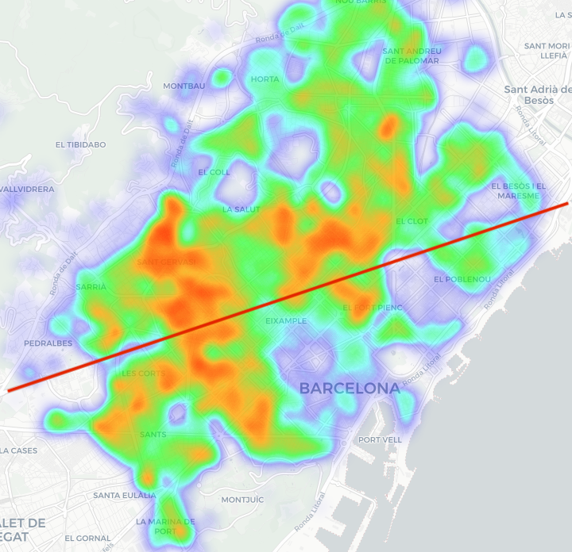

# Vivienda en Barcelona: un análisis desde el Catastro

Código y visualizaciones del análisis sobre la antigüedad, el tamaño y la distribución de las viviendas de Barcelona a partir de datos del Catastro.

**[Leer el artículo completo en pabloreyes.es →](https://pabloreyes.es/vivienda-catastro-barcelona-machine-learning/)**

Pablo Reyes · 3 de febrero de 2020

[](https://pabloreyes.es/vivienda-catastro-barcelona-machine-learning/)

*Una de las visualizaciones del post: mapa de calor ponderado por la superficie de las viviendas. La línea roja señala la Diagonal. Pulsa la imagen para leer el artículo.*

## El resultado

- Evolución de la construcción de viviendas y de su superficie a lo largo del siglo XX.
- Comparaciones entre distritos y entre calles de Barcelona.
- Mapas para explorar cómo se distribuyen las viviendas y sus tamaños.

El artículo reúne los gráficos, la interpretación y el contexto del proyecto. El notebook contiene el trabajo de preparación y análisis que lo acompaña.

## Explorar el repositorio

| Archivo | Contenido |
| --- | --- |
| [analisis_catastro.ipynb](analisis_catastro.ipynb) | Preparación de datos, análisis temporal, distritos, calles y mapas con `ipyleaflet`. Incluye salidas guardadas. |
| [docs/images/heatmap.png](docs/images/heatmap.png) | Imagen original del blog, incluida como vista previa del resultado. |
| [LICENSE](LICENSE) | Licencia GPL-3.0 del proyecto. |

Puedes abrir el notebook directamente en GitHub para consultar el código y los gráficos estáticos guardados. Los mapas interactivos requieren un entorno Jupyter con soporte de widgets; la imagen de arriba permite ver el resultado sin ese entorno.

## Datos y reproducción

**El dataset catastral no está incluido por su tamaño.** El notebook lee este fichero local:

```text
data/barcelona/catastro_barcelona_clean_save.csv
```

La sección inicial «Prepare Data» conserva, comentado, el proceso de preparación a partir de cuatro CSV intermedios:

```text
data/barcelona/CategoriaCAT_11_fincas.csv
data/barcelona/CategoriaCAT_13_unidad_constructiva.csv
data/barcelona/CategoriaCAT_14_construcciones.csv
data/barcelona/CategoriaCAT_15_inmuebles.csv
```

Proceden de ficheros `.CAT` del Catastro convertidos con [cat2csv](https://github.com/GuillemHerrera/cat2csv). El proceso une registros por parcela catastral e incorpora distrito, año de construcción y coordenadas.

Para reconstruir el dataset hay que obtener los ficheros de Barcelona, convertirlos y revisar esa sección antes de ejecutarla. Su exportación usa `catastro_barcelona_clean.csv`, mientras que la lectura posterior espera `catastro_barcelona_clean_save.csv`: hay que unificar ambas rutas. La indicación del notebook de que el fichero «ya está en /DATA/» se refiere al entorno original del autor.

El notebook se creó con **Python 3.7.3** y utiliza `pandas`, `numpy`, `matplotlib`, `scipy`, `scikit-learn`, `pyproj`, `pandarallel`, `ipyleaflet` e `ipywidgets`. No se conserva un entorno con versiones fijadas; una ejecución con librerías actuales requiere adaptar las API antiguas.

## Alcance

Es un análisis exploratorio publicado en 2020. El código selecciona construcciones posteriores a 1900 y viviendas de al menos 20 m², tras filtrar superficies atípicas y distritos con valor cero. Las envolventes convexas de los mapas aproximan distritos a partir de una muestra; no son límites administrativos oficiales.

Autor: [Pablo Reyes](https://pabloreyes.es/) · [Artículo y resultados](https://pabloreyes.es/vivienda-catastro-barcelona-machine-learning/) · [GPL-3.0](LICENSE)
